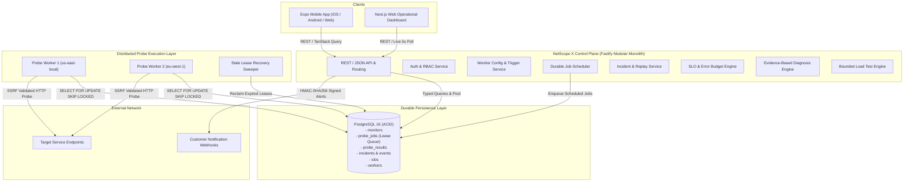
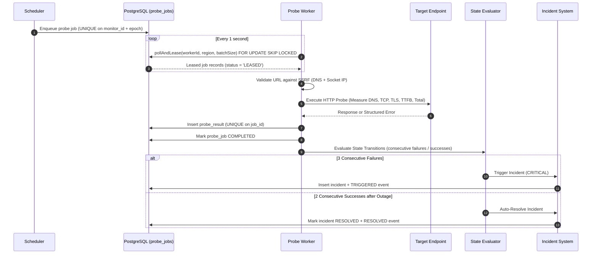
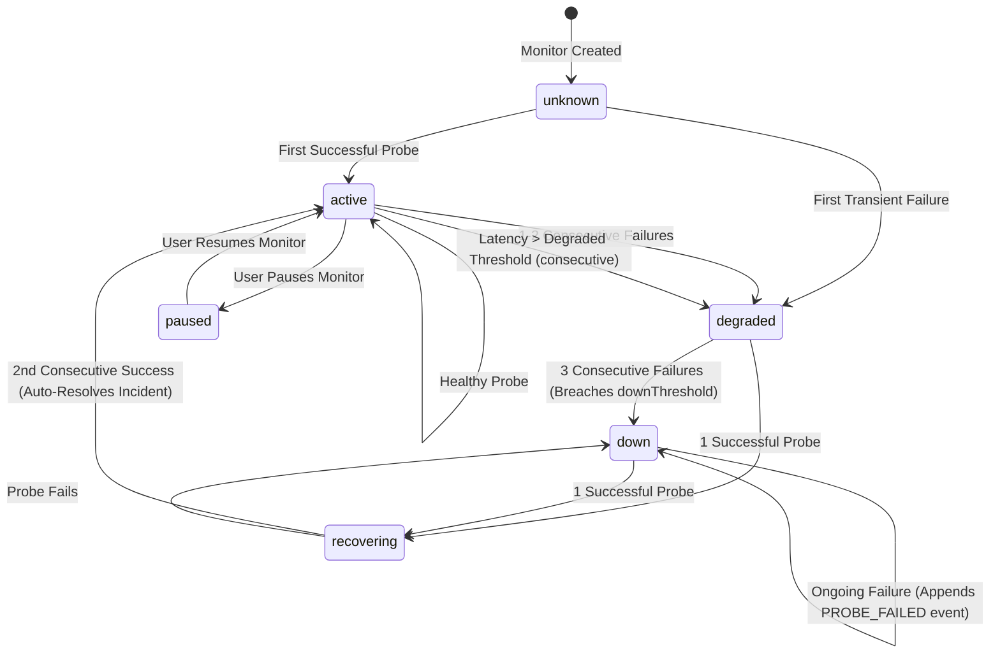
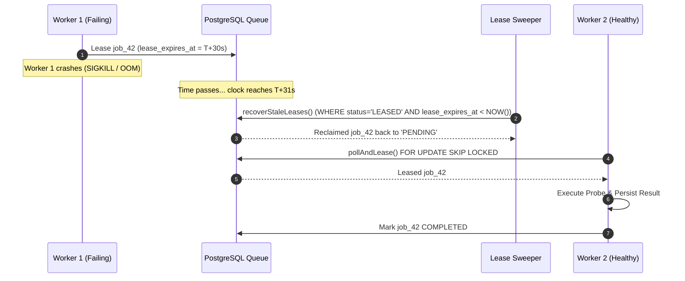

# NetScope X System Architecture & Data Flow

## 1. High-Level Component Boundaries

---

## 2. Monitoring Job & Result Lifecycle

---

## 3. Monitor Lifecycle State Machine

---

## 4. Worker Crash & Automatic Lease Recovery

